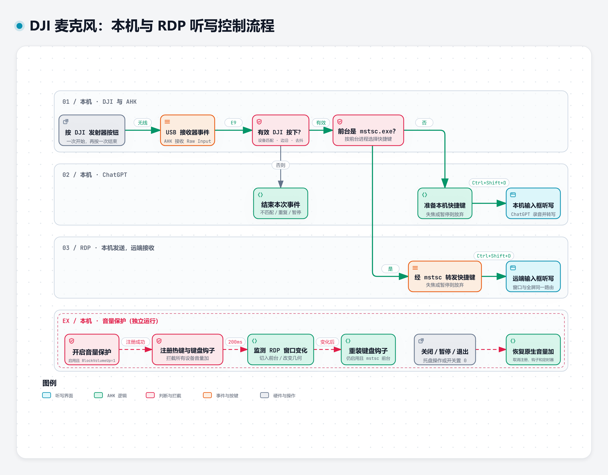

# Solis_DJImic_Hotkey

汉化 AutoHotkey 常用界面，用 DJI 按钮触发本机或 RDP 的 ChatGPT 输入框听写。

## ✨ 用途与适用范围

原部署机器已用 `Ctrl+Shift+D` 验证本机和 RDP 听写。其他场景和设备请按[测试步骤](docs/MANUAL.md#verify)检查。

## 🗺️ 控制流程



[交互版 HTML](docs/diagrams/dji-local-rdp.html)（在文件页下载后用浏览器打开） · [可编辑图源](docs/diagrams/dji-local-rdp.workflow.json)

## 🧰 准备条件

接好 DJI 接收器并配对发射器，麦克风选择 `Wireless Mic Rx`。先在本机和远端的 ChatGPT 聊天输入框用 `Ctrl+Shift+D` 验证听写。

## 🚀 安装或接入

从 [GitHub 仓库](https://github.com/Solismuchengxue/Solis_DJImic_Hotkey) 选择 Code → Download ZIP 并解压。按[安装步骤](docs/MANUAL.md#install)操作：安装 AHK v2.0.31 → 备份汉化 → 配置 ChatGPT → 部署 DJI 脚本 → 测试。

## 🎬 第一次使用

1. 托盘确认“DJI 听写绑定：已启用”。
2. 点进本机或 RDP 中的 ChatGPT 输入框，DJI 按一次开始，再按一次结束。
3. 检查转写文字后发送。

手动启动：双击 `D:\AutoHotkey\DJI_Mic_Hotkey.ahk`。关联异常时，按 `Win+R` 输入：

```text
"D:\AutoHotkey\v2\AutoHotkey64.exe" "D:\AutoHotkey\DJI_Mic_Hotkey.ahk"
```

## 🛠️ 日常使用与求助

- **改键**：修改两端 ChatGPT 设置和 `D:\AutoHotkey\DJI_Mic_Hotkey.ini`，保存后从托盘“重新读取配置”。
- **改代码**：退出旧实例，再启动；重复双击不会加载新代码。
- **暂停/退出**：从 DJI 托盘菜单操作。
- [自启动维护](docs/MANUAL.md#autostart) · [升级维护](docs/MANUAL.md#maintenance) · [原理](docs/MANUAL.md#mechanism) · [排错恢复](docs/MANUAL.md#troubleshooting)

完整操作见[使用与维护手册](docs/MANUAL.md)；项目目标与验收见 [BLUEPRINT](docs/BLUEPRINT.md) 和 [PRD](docs/PRD.md)。

## 📄 限制与许可

**当前会屏蔽所有设备的音量加键。** 暂停或退出可恢复；也可用 Windows 音量滑块调节。

已验证 AHK v2.0.31，常用界面已汉化，部分内置提示仍为英文。可选装由 wyagd001 发布的[简体中文离线帮助 2.0.19](docs/MANUAL.md#chinese-help)。汉化文件沿用上游 GPL v2，见[来源与许可](THIRD_PARTY_NOTICES.md)。
