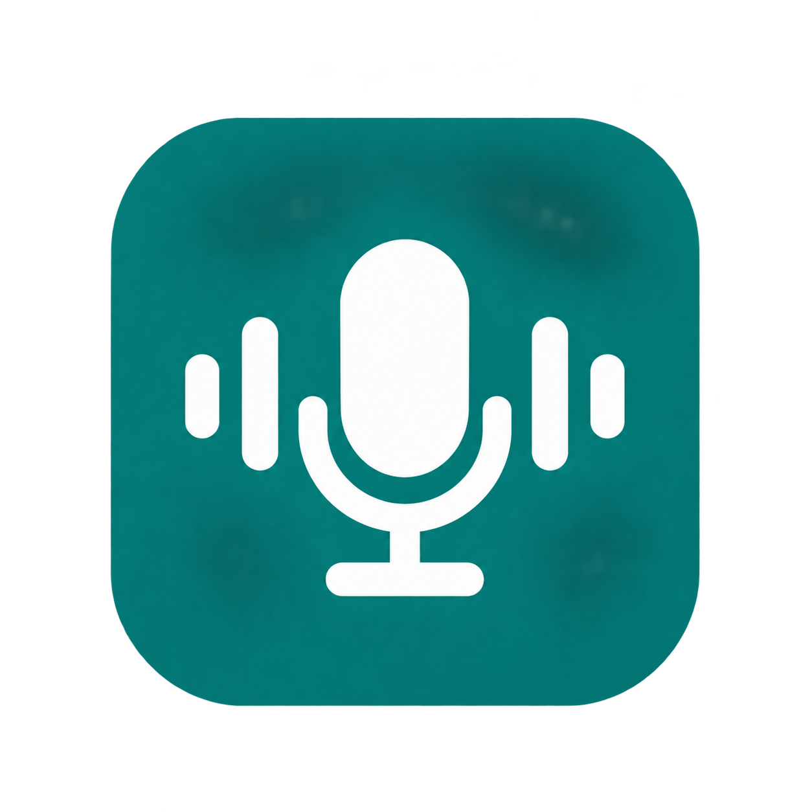
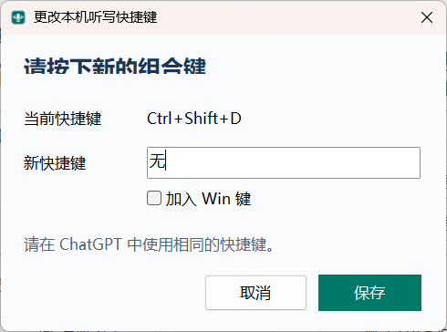
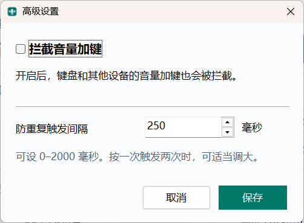
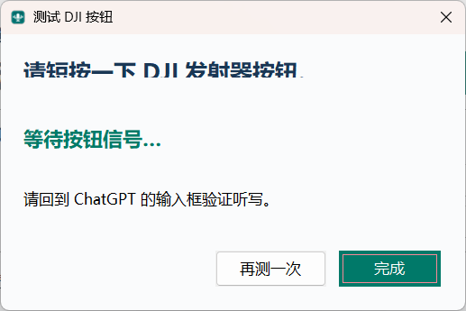

# Solis_DJImic_Hotkey

汉化 AutoHotkey 常用界面，用 DJI 按钮触发本机或 RDP 的 ChatGPT 输入框听写。

## ✨ 用途与适用范围

当前实测设备为 **DJI Mic Mini 2S**，覆盖本机、RDP 窗口和全屏的 ChatGPT 输入框听写。两端默认快捷键为 `Ctrl+Shift+D`。其他设备和场景请按[测试步骤](docs/MANUAL.md#verify)检查。

## 🧰 准备条件

接好 DJI 接收器并配对发射器，麦克风选择 `Wireless Mic Rx`。先在本机和远端的 ChatGPT 聊天输入框用 `Ctrl+Shift+D` 验证听写。

## 🚀 安装或接入

已发布的便携版可从 [GitHub Releases](https://github.com/Solismuchengxue/Solis_DJImic_Hotkey/releases) 下载。解压便携 ZIP 后双击 `DJI 听写.exe`，按[便携版步骤](docs/MANUAL.md#portable)启用。

单独安装的 AutoHotkey 可按[汉化步骤](docs/MANUAL.md#install)应用中文菜单和设置。

## 🎬 第一次使用

1. 在便携版主界面点「启动绑定」，确认显示「运行中」。
2. 点进本机或 RDP 中的 ChatGPT 输入框，DJI 按一次开始，再按一次结束。
3. 检查转写文字后发送。

## 界面预览

`v0.1.1` 的 Windows 实际界面。

| 主窗口 | 更改快捷键 | 高级设置 | DJI 按钮测试 |
| :---: | :---: | :---: | :---: |
|  |  |  |  |

## 🛠️ 日常使用与求助

- **改键**：在主界面更改本机或 RDP 快捷键，并同步 ChatGPT 的单击听写快捷键。
- **暂停/退出**：从 DJI 托盘菜单操作。
- [自启动维护](docs/MANUAL.md#autostart) · [升级维护](docs/MANUAL.md#maintenance) · [原理](docs/MANUAL.md#mechanism) · [排错恢复](docs/MANUAL.md#troubleshooting)

完整操作见[使用与维护手册](docs/MANUAL.md)；项目目标与验收见 [BLUEPRINT](docs/BLUEPRINT.md) 和 [PRD](docs/PRD.md)。

## 🗺️ 控制流程

[交互版 HTML](docs/diagrams/dji-local-rdp.html)（在文件页下载后用浏览器打开） · [可编辑图源](docs/diagrams/dji-local-rdp.workflow.json)

## 📄 限制与许可

启用音量加拦截时，键盘音量加也会被拦截。便携版默认关闭此项，暂停或退出绑定可恢复音量加。

安装版汉化适配 AutoHotkey v2.0.31，部分内置提示为英文。可选装 wyagd001 的[简体中文离线帮助 2.0.19](docs/MANUAL.md#chinese-help)。汉化文件沿用上游 GPL v2，见[来源与许可](THIRD_PARTY_NOTICES.md)。
