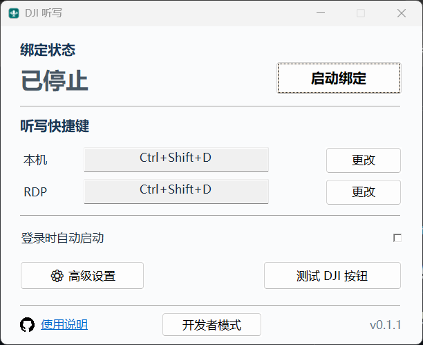

# Solis_DJImic_Hotkey

汉化 AutoHotkey 常用界面，用 DJI 按钮触发本机或 RDP 的 ChatGPT 输入框听写。

当前实测设备为 **DJI Mic Mini 2S**，覆盖本机、RDP 窗口和全屏的 ChatGPT 输入框听写。

## 🚀 第一次使用

1. **下载并打开。** 在 Windows x64 上，从 [GitHub Releases](https://github.com/Solismuchengxue/Solis_DJImic_Hotkey/releases) 的 Assets 下载 `Solis_DJImic_Hotkey_v<版本号>_windows-x64.zip`。右键「全部解压缩」，打开解压后的目录，双击 `DJI 听写.exe`。便携包自带 AutoHotkey。
2. 把 USB-C 接收器插到本机，打开发射器并确认已配对。在 Windows 和 ChatGPT 的麦克风设置中选择 `Wireless Mic Rx`。
3. 在 ChatGPT 的「设置 → 语音 → 听写 → 单击快捷键」设为 `Ctrl+Shift+D`，上方的按住或双击入口保持关闭。点进聊天输入框，用键盘按一次开始听写，说一句话，再按一次结束。看到文字出现在输入框后，再试 DJI。
4. 回到 DJI 听写主窗口，点「启动绑定」，确认显示「运行中」。重新点进 ChatGPT 输入框，短按一次 **DJI 发射器**的按钮开始听写，说完再短按一次结束。确认转写正确后发送。

用 RDP 时，程序仍在连接接收器的本机运行。连接前在远程桌面客户端选择「本地资源 → 远程音频 → 设置 → 远程音频录制 → 从此计算机录制」。连接后，在远端选用重定向的麦克风，再按第 3 步设置并验证远端 ChatGPT。

如果键盘快捷键能听写、DJI 短按无反应，点主界面的「测试 DJI 按钮」。该窗口只检查按钮信号。看到「已收到按钮信号」后，点「完成」，确认绑定仍在运行，再回到聊天输入框测试听写。

## 🔊 拦截音量加键

DJI 发射器短按会发出 Windows 的「音量加」事件。程序用这个事件触发听写。默认关闭拦截，所以短按 DJI 时可能同时调高系统音量。

如果希望 DJI 短按只触发听写，在主窗口点「高级设置」，勾选「拦截音量加键」，再点「保存」。绑定运行时，实体键盘和其他设备的音量加也会被拦截。可用 Windows 音量滑块调音量，或取消勾选、暂停、停止绑定或退出程序来恢复实体音量加键。

## 界面预览

`v0.1.1` 开发版的 Windows 实际界面。

| 主窗口 | 更改快捷键 | 高级设置 | DJI 按钮测试 |
| :---: | :---: | :---: | :---: |
|  |  |  |  |

## 🛠️ 日常使用与求助

- **改键**：在主界面更改本机或 RDP 快捷键，并同步 ChatGPT 的单击听写快捷键。
- **暂停/退出**：从 DJI 托盘菜单操作。
- [自启动维护](docs/MANUAL.md#autostart) · [升级维护](docs/MANUAL.md#maintenance) · [原理](docs/MANUAL.md#mechanism) · [排错恢复](docs/MANUAL.md#troubleshooting)

完整操作见[使用与维护手册](docs/MANUAL.md)；项目目标与验收见 [BLUEPRINT](docs/BLUEPRINT.md) 和 [PRD](docs/PRD.md)。

## 🗺️ 控制流程

[交互版 HTML](docs/diagrams/dji-local-rdp.html)（在文件页下载后用浏览器打开） · [可编辑图源](docs/diagrams/dji-local-rdp.workflow.json)

## 📄 限制与许可

其他设备和场景可按手册验证。[测试步骤](docs/MANUAL.md#verify)

单独安装的 AutoHotkey v2.0.31 可应用汉化，部分内置提示保留英文。汉化文件沿用上游 GPL v2。[汉化步骤](docs/MANUAL.md#install) · [来源与许可](THIRD_PARTY_NOTICES.md)
