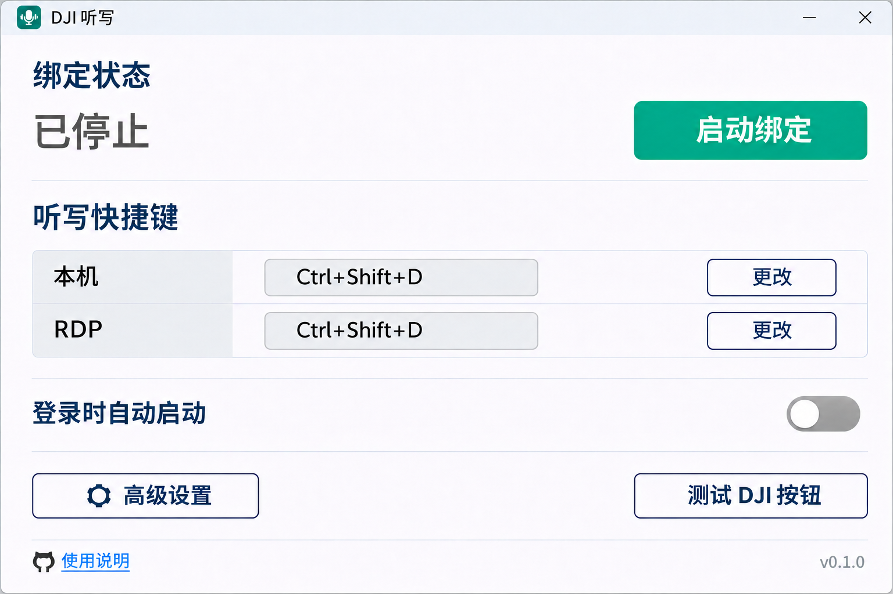
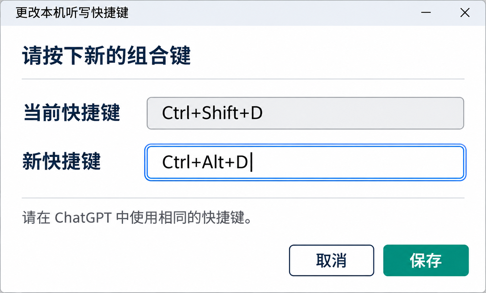
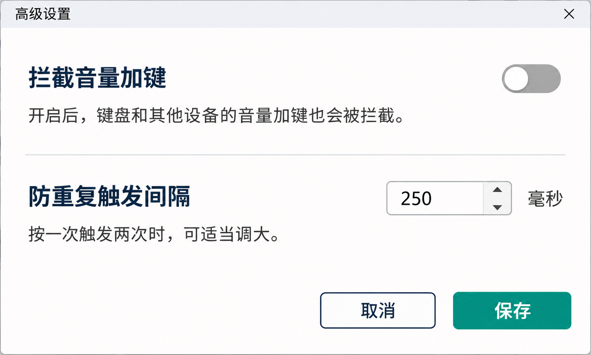
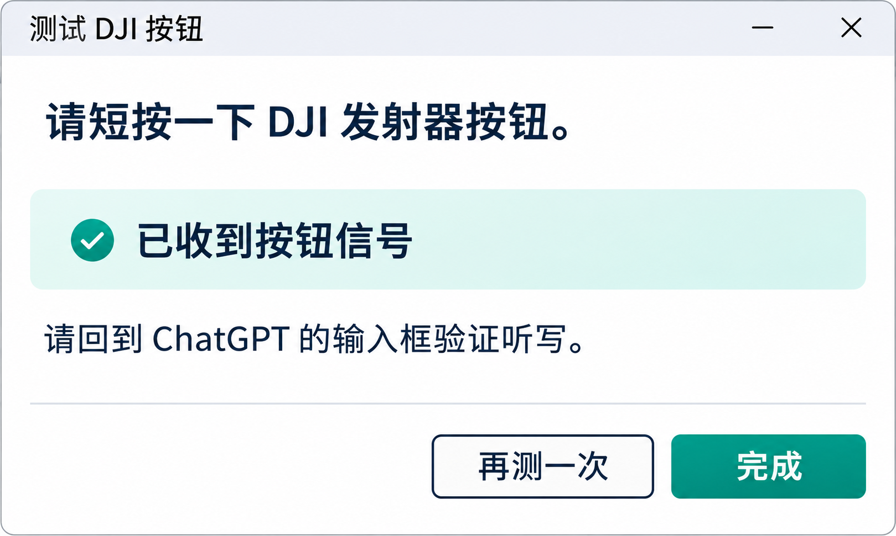
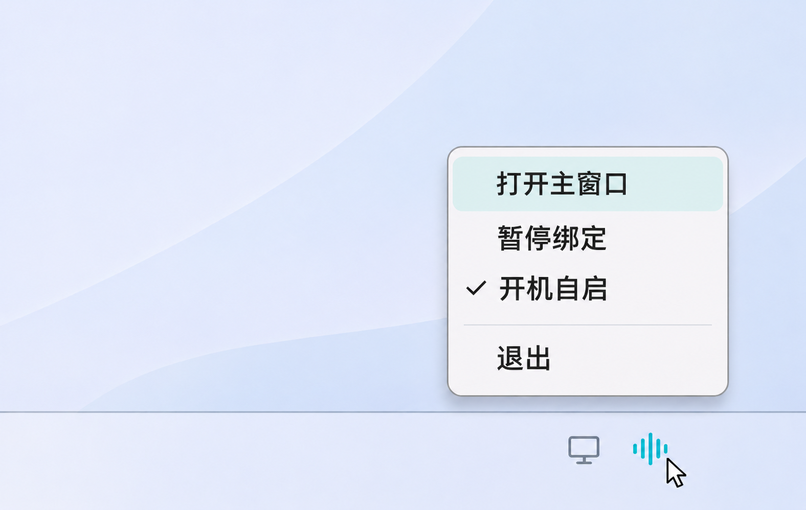

# 便携版界面概念图

这组图用于后续界面开发。当前使用步骤见[使用与维护手册](../MANUAL.md)。

## 主窗口

双击程序打开主窗口，可以启动绑定、分别修改本机和 RDP 的快捷键，以及切换自启动。底部的 GitHub 图标和「使用说明」共用一个入口，直达项目手册。图中的 `v0.1.0` 用于示意版本号位置。

## 更改快捷键

本机和 RDP 共用同一种弹窗。按下新组合键，确认后保存。

## 高级设置

音量加拦截默认关闭，防重复触发间隔默认 `250 毫秒`。

## DJI 按钮测试

确认程序收到 DJI 按钮信号后，回到 ChatGPT 输入框验证听写。

## 托盘右键菜单

可打开主窗口、暂停或恢复绑定、切换开机自启和退出。勾号表示开机自启已开启，与主窗口同步。

